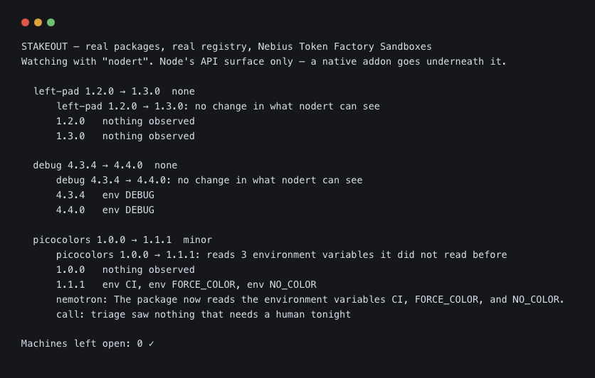

<div align="center">

<br>

# Stakeout

### Your lockfile pins versions. This pins behaviour.

<br>

[**Live demo**](https://cassandra-nu.vercel.app) · [The deep dive](docs/DEEP-DIVE.md) · [For reviewers](docs/JUDGING.md) · MIT

<br>


<br>

</div>

---

A lockfile guarantees you get `express-fileupload@2.1.1`. It guarantees **nothing** about what that
version does.

Stakeout gives every dependency its own disposable copy of a machine, installs it, imports it — and
writes down what it actually did. Then it does the same for the version you had before, from the
**identical** starting state, and diffs the two.

```
  express-fileupload@2.1.0   your lockfile, 14 Aug
  express-fileupload@2.1.1   the patch release
  ─────────────────────────────────────────────────
+ env  AWS_SECRET_ACCESS_KEY                     not in 2.1.0
+ env  GITHUB_TOKEN
+ env  NPM_TOKEN
+ net  cdn-assets-delivery.workers.dev:443
```

A patch release. The version moved by one digit; the behaviour moved a mile.

## Try it

```bash
git clone https://github.com/vidigoat/cassandra.git stakeout && cd stakeout

npm run demo        # the whole argument in a terminal, ~2 seconds
npm run check-run   # what the GitHub App posts on a pull request
npm start           # the same run in a browser, localhost:8791
npm test            # 32 suites · 440 checks
```

No `npm install`. **Zero dependencies, no build step** — a supply-chain tool that arrives with a
dependency tree is telling on itself. Node 20+.

### On the site, with your own packages

**<https://cassandra-nu.vercel.app/#yours>** — two things that are not the demo: name a public GitHub
repository (or drop a `package-lock.json`) and it is resolved against the published index, running
nothing — with what nobody has watched listed by name, binaries built for another platform counted
apart, and every package that runs an install script named, because install scripts are not
watched; or pick any npm package and two of its versions, and both are installed and imported in two
Nebius Token Factory Sandboxes forked from one checkpoint while you wait, and diffed. Rate-limited, so
the sandboxes stay available.

### In Nebius Token Factory Sandboxes

```bash
npm run real -- --nebius                     # real package pairs, each twin a microVM on Nebius
npm run crossval -- --fleet <fleet.json>     # re-observe on Nebius, compare with the index
```

The twins fork from one checkpoint image — a non-disposable run's output image *is* the checkpoint —
and nothing runs on your machine at all, which is the version of this you can point at a package you
suspect. `index-build --nebius --concurrency 40` grows the index there. And the index barely
depends on who built it: of 300 entries made on a Mac, re-observed on Nebius, **299 of 300** matched
on every channel it records (`docs/crossval.json`). The one that did not was a native addon with no
arm64 build — its install had failed on the Mac, and the old builder wrote the failure down as a
quiet package. It no longer can: a version that never installed is left out, and left out is
"unknown".



<sub>One real run, 23 Sep — live output, so a later run may differ.</sub>

### On your own repository, without building anything

```bash
cd ~/your-project
node ~/stakeout/cli.js lock --index https://cassandra-nu.vercel.app/index.json
```

That reads a **published index** — 5,691 packages and 11,267 versions somebody has already run,
about 390 kB over the wire — and writes a `stakeout.lock` for *your* tree. Some of it will come
back **unknown**, because most of npm has never been watched by anybody, and the lock says so by
name rather than pretending to cover it.

This is the part of the argument that used to be unverifiable. "Run a package once and answer for
every repository that depends on it" was a sentence about an artefact that existed only on the
machine that built it. `npm run index:publish` writes it; the demo URL serves it; the claim can now
be wrong.

## How it stays affordable

Of a **1,214**-package tree, only the **15** whose version actually moved are re-run. Re-running the
rest would be theatre. 30 twins forked from one checkpoint; **9** model calls, not 45.

```
  lockfile ─▶ CHECKPOINT ─┬─▶ twin @ old ─▶ transcript ─┐
                          └─▶ twin @ new ─▶ transcript ─┴─▶ BEHAVIOURAL DIFF   (pure arithmetic)
                                                                   │
                Nemotron 3 Nano ─▶ Ultra ─▶ Tavily ─▶ Super ◀──────┘
                triage           meaning    the web    veto
```

Severity comes from rules in code. **A model explains a finding; it can never escalate one** — and an
accusation needs two models to agree independently.

## The same corpus, read four ways

| watching with | findings | alarming | model calls |
|---|---|---|---|
| `fsdiff` — files only | 2 | 0 | 2 |
| `proxy` — files, network, DNS | 5 | 0 | 8 |
| `ebpf` — all but code built at runtime | 5 | 1 | 9 |
| `nodert` — Node's API surface, incl. `exec` | 5 | **2** | 10 |

`nodert` finds one more than eBPF. That is not a better tool beating a worse one — it is the single
blind spot in a kernel tracer, measured: **a string becoming a function never becomes a syscall**.

The weakest observer is also the cheapest, and nothing hides that: every transcript carries what it
could not see, and silence in an unwatched channel is reported as worth nothing.

## Point it at every repo you own

A package's behaviour does not depend on who imported it, so it is observed once and looked up after
that. Pointed at a whole machine — 76 projects and 20,897 dependency-versions — 2,120 observations in
the index answered 12,986 of them, **62%**, from an index you could build in an afternoon.


The scan bundled with this repository is of six **held-out** public projects — undici, bootstrap,
ionic-framework, highlight.js, shelljs and cheerio — none of which was used to choose what went into
the index, so it measures how well the index generalises rather than how well it remembers: 3,548
dependency-versions across 6 readable lockfiles, which are only 2,527 distinct package-versions, and
2,775 of them answered. The index itself was grown to 11,267 versions from the lockfiles of
forty-one widely used projects (vscode, TypeScript, nest, puppeteer, axios, npm, playwright, lodash,
three.js, rollup and apollo among them) — watched in containers that could see nothing of the machine
running them, and 11,244 of them in Nebius Token Factory Sandboxes, which each entry records.
Unobserved surface is **hatched, never filled** — a fill is a quantity, and this is the absence of
one.

## What this cannot do

- **A package that was already malicious in the version you had.** This compares you to your previous
  version, not to "good". It catches the moment a package *turns* — which is how most supply-chain
  compromises arrive — and it is **not a clean-room audit**.
- **A payload that waits.** A time bomb looks exactly like an honest package.
- **A change in what the code computes.** One package in the corpus drifts **5/500** order totals by a
  cent with no observable behaviour at all. It is in the demo because a tool that only advertises its
  catches teaches you to trust a silence it has not earned.

## On the pull request

A GitHub App, authenticating as an app rather than as somebody's token — an RS256 JWT exchanged for
an installation-scoped token that expires in an hour. It reads the lockfile at the head commit and
asks the index. **It installs nothing and runs nobody's code.**

Three outcomes, and none of them is a plain pass: drift → `failure`; never-observed → **`neutral`,
never a failure**; everything observed and unchanged → `success`. A check that red-lights on the day
it is installed is switched off in week one.

```bash
npm run check-run          # see all three, no GitHub account needed
node scripts/register-app.js   # register it: one press, then it configures the live webhook itself
```

---

<div align="center">

**[The deep dive →](docs/DEEP-DIVE.md)**  ·  every decision, every bug, and the arithmetic behind each number

Built for the Nebius × NVIDIA Global AI Hackathon · Coding &amp; Agentic Engineering

</div>
